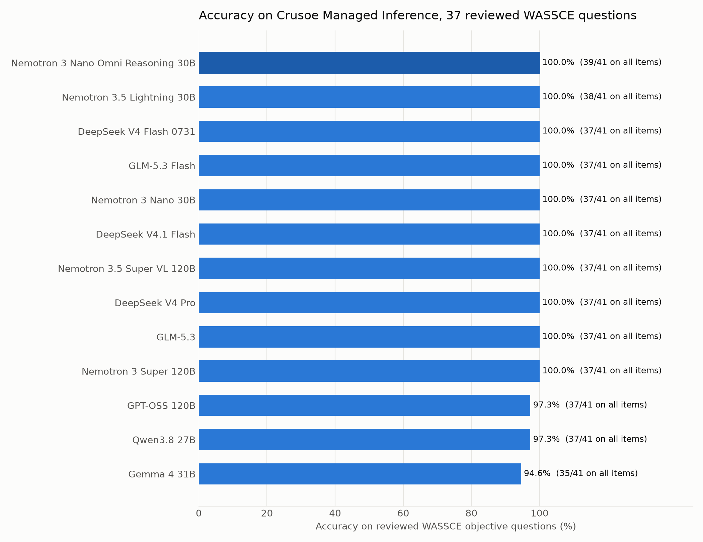
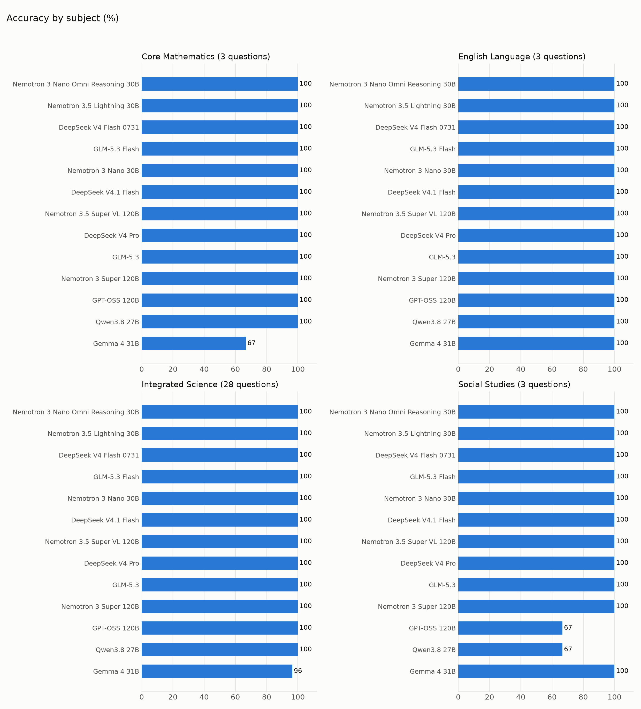
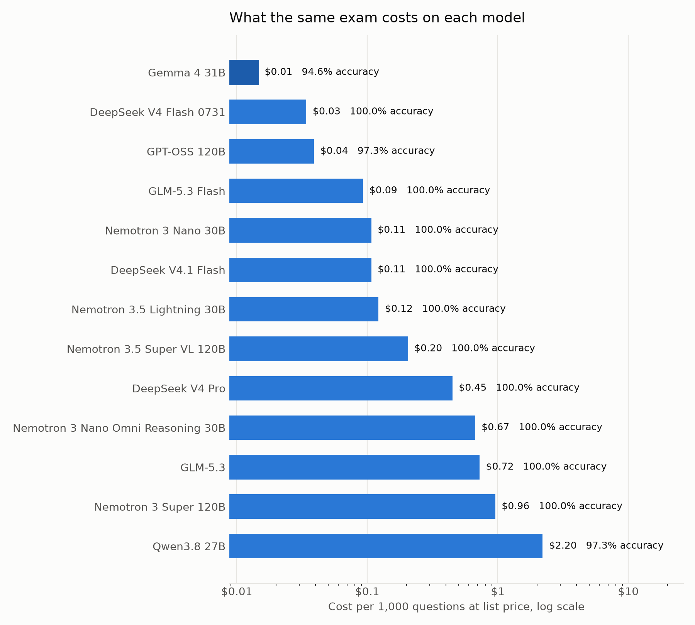
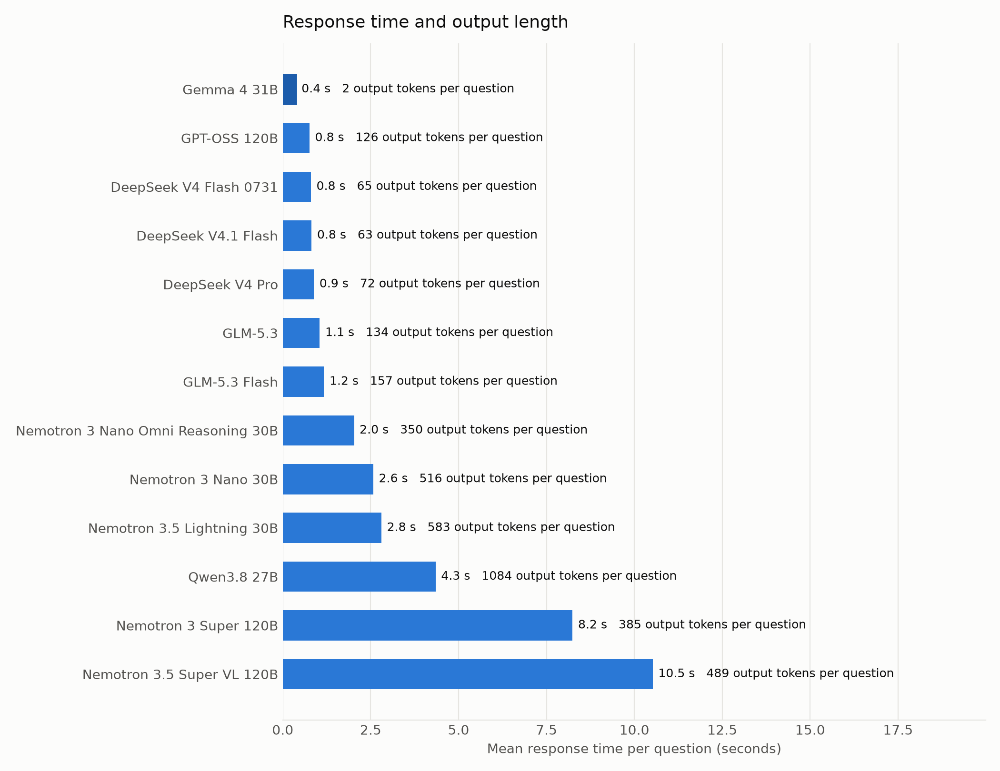

# WASSCE Benchmark for Open Models on Crusoe Managed Inference

Thirteen open models, one West African exam, one API.

This repo runs every chat model served on [Crusoe Managed Inference](https://docs.crusoe.ai/serverless-inference/) against objective questions from the West African Senior School Certificate Examination (WASSCE), the exam that gates university admission for about two million candidates a year across Ghana, Nigeria, Sierra Leone, Liberia and The Gambia. Same prompt, temperature 0, one pass per question, scored against the official key.

Everything needed to rerun it is here: the question bank, the runner, the raw per-question records, the summary files, the charts and the [write-up](article.md).

## Headline results

Run date: 5 November 2026. 41 questions, 13 models, 533 model answers, total list-price cost about 23 cents.

Ten of the thirteen models answered every reviewed question correctly. "Reviewed" means the 37 questions whose answer key survived a check; four keys in the source data disagree with physics, arithmetic or horticulture and are listed in [data/suspect_keys.json](data/suspect_keys.json). The "all items" column scores against the key as published.

| Rank | Model on Crusoe | Reviewed (37) | All items (41) | Cost per 1k questions | Mean latency | Output tokens per question |
|---|---|---|---|---|---|---|
| 1 | nvidia/Nemotron-3-Nano-Omni-Reasoning-30B-A3B | 37/37 | 39/41 | $0.67 | 2.0 s | 350 |
| 2 | nvidia/Nemotron-3.5-Lightning-30B-A3B | 37/37 | 38/41 | $0.12 | 2.8 s | 583 |
| 3 | deepseek-ai/Deepseek-V4-Flash | 37/37 | 37/41 | $0.03 | 0.8 s | 65 |
| 4 | zai-org/GLM-5.3-Flash | 37/37 | 37/41 | $0.09 | 1.2 s | 157 |
| 5 | deepseek-ai/DeepSeek-V4.1-Flash | 37/37 | 37/41 | $0.11 | 0.8 s | 63 |
| 6 | nvidia/NVIDIA-Nemotron-3-Nano-30B-A3B | 37/37 | 37/41 | $0.11 | 2.6 s | 516 |
| 7 | nvidia/NVIDIA-Nemotron-3.5-Super-VL | 37/37 | 37/41 | $0.20 | 10.5 s | 489 |
| 8 | deepseek-ai/DeepSeek-V4-Pro | 37/37 | 37/41 | $0.45 | 0.9 s | 72 |
| 9 | zai-org/GLM-5.3 | 37/37 | 37/41 | $0.72 | 1.1 s | 134 |
| 10 | nvidia/NVIDIA-Nemotron-3-Super-120B-A12B | 37/37 | 37/41 | $0.96 | 8.2 s | 385 |
| 11 | openai/gpt-oss-120b | 36/37 | 37/41 | $0.04 | 0.8 s | 126 |
| 12 | Qwen/Qwen3.8-27B | 36/37 | 37/41 | $2.20 | 4.3 s | 1084 |
| 13 | google/gemma-4-31b-it | 35/37 | 35/41 | $0.01 | 0.4 s | 2 |

Cost uses the list prices on the [Crusoe pricing page](https://www.crusoe.ai/cloud/pricing#Serverless-Inference) on the run date. Latency is the mean wall-clock time of each successful request from a laptop. DeepSeek V4 Flash 0731, DeepSeek V4 Pro, Nemotron 3 Nano 30B and Nemotron 3 Super 120B were still served on the run date but are on the deprecation list dated 2 November 2026.

Most accurate: Nemotron 3 Nano Omni Reasoning 30B, the only model to clear 39 of the 41 published keys. Its two extra points over the pack come from agreeing with two of the disputed keys.

Best value in the current catalog: GLM-5.3 Flash, a perfect reviewed score at nine cents per thousand questions. DeepSeek V4.1 Flash matches it on accuracy, is the fastest of the perfect scorers at 0.8 seconds, and costs two cents more per thousand.









## The question bank

41 four-option questions in four subjects, stored as `data/<subject>/questions.json`:

| Subject | Questions | Source |
|---|---|---|
| Integrated Science | 32 | 29 from the 2007 paper via the Hugging Face dataset `worldboss/waec-integrated-science-2007`, plus 3 sample items |
| Core Mathematics | 3 | sample items |
| English Language | 3 | sample items |
| Social Studies | 3 | sample items |

`tools/convert_hf_science_2007.py` rebuilds the 2007 set from the Hugging Face rows. The sample items are short hand-written questions in the style of the paper, used to keep all four subjects present.

Each question looks like this:

```json
{
  "id": "integrated_science_2007_014",
  "subject": "integrated_science",
  "year": 2007,
  "question_number": 14,
  "question": "A machine has a velocity ratio of 9 and needs an effort of 10 N to lift a load of 50 N. Calculate its efficiency.",
  "options": {"A": "20%", "B": "45%", "C": "55.6%", "D": "90%"},
  "correct_answer": "C",
  "topic": "general"
}
```

Drop a new `questions.json` into a subject folder and the runner picks it up. This is the part of the repo that most needs help: see Contributing.

## Running it

You need a Crusoe API key from the [Crusoe console](https://console.crusoecloud.com/) and [uv](https://docs.astral.sh/uv/).

```bash
git clone https://github.com/acheamponge/wassce-open-models-benchmark.git
cd wassce-open-models-benchmark
cp .env.example .env
```

Put the key in `.env` as `CRUSOE_API_KEY`. The runner loads `.env` with override on, so a stale key exported in your shell does not win.

```bash
uv sync
uv run bench.py --list-models
```

That prints every chat model on the live `/v1/models` endpoint and flags any that are not in `models.json` (they still run, just without a cost figure). Speech, embedding and other non-chat models are skipped by name pattern.

```bash
uv run bench.py --sample 12 --out results/pilot
```

A pilot across all models on a stratified subset, with the same questions for every model.

```bash
uv run bench.py
uv run charts.py
uv run tools/per_question.py
```

The full run, the charts, and the per-question breakdown (`results/per_question.md` and `.csv`) that shows which models missed which items.

Flags: `--models a,b` to pick models, `--workers` for concurrent requests per model, `--model-parallel` for models run at once, `--max-tokens` for the completion budget (default 16384), `--fresh` to discard earlier raw records. Runs resume: an answered question is not sent again, and answers that hit the token limit without a letter are retried on the next run.

## How scoring works

The prompt names the exam and subject, lists the four options and asks for the letter only. The parser looks for an explicit "answer: X", then a leading letter on the first or last line, then a single standalone letter, then a unique match on option text. Anything else counts as wrong and is reported in the `unparsed` column.

Thinking models get the same prompt and the same budget. Their reasoning tokens are billed as output and are included in the cost column, which is why Qwen3.8 27B costs 150 times what Gemma 4 31B costs for the same questions.

Requests that return 429 or 503 are retried with exponential backoff and jitter, honouring `Retry-After`. The Crusoe endpoint returns 429 when a project exceeds its per-model rate limit and 503 when the shared endpoint is under load; both are transient.

## Output files

```
results/raw/<model>.jsonl      one record per question: predicted letter, correctness, tokens, latency, finish reason
results/summary.json           run metadata and per-model totals, including per-subject splits
results/summary.csv            the same, one row per model
results/by_subject.csv         long format, one row per model and subject
results/run_meta.json          run date, endpoint, temperature, max tokens, prompt template, model ids
results/per_question.md        every question with its key and the models that missed it
charts/*.png                   the four charts above
```

## Contributing

The most useful contribution is more questions with verified keys from publicly available past papers, especially Core Mathematics, English and Social Studies, which are thin here. Follow the JSON format above, keep the subject folder name, and open a pull request. If you find a key you believe is wrong, add it to `data/suspect_keys.json` with the reason.

To add a model from another OpenAI-compatible provider, set `CRUSOE_BASE_URL` and add the model id and prices to `models.json`.

## License

MIT. The questions derive from publicly available past papers and are included for research and evaluation.
