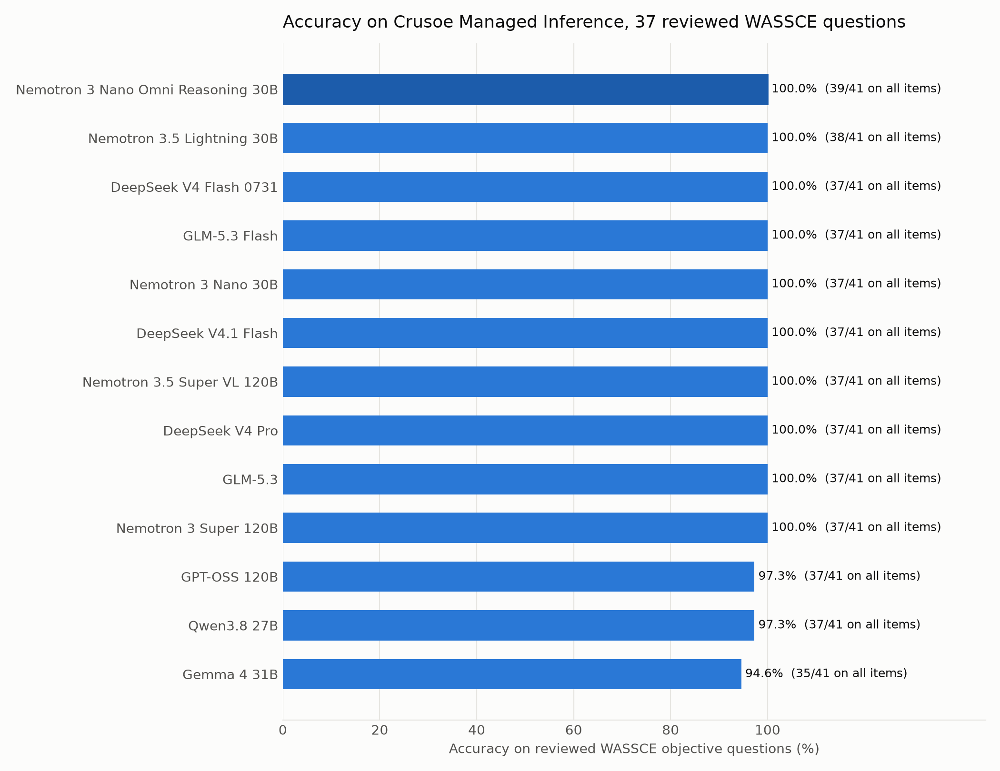
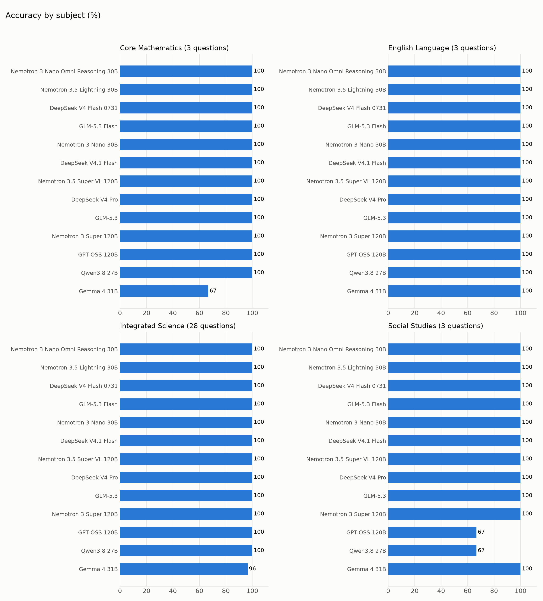
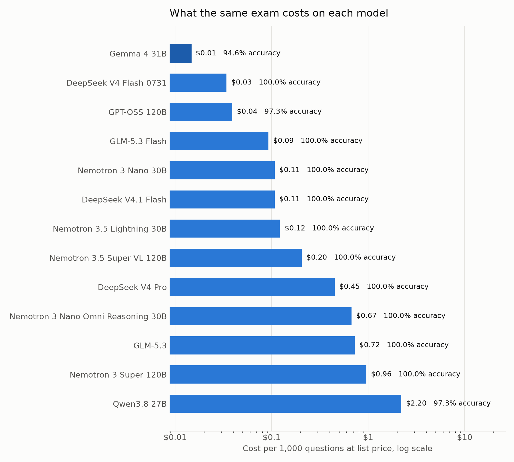
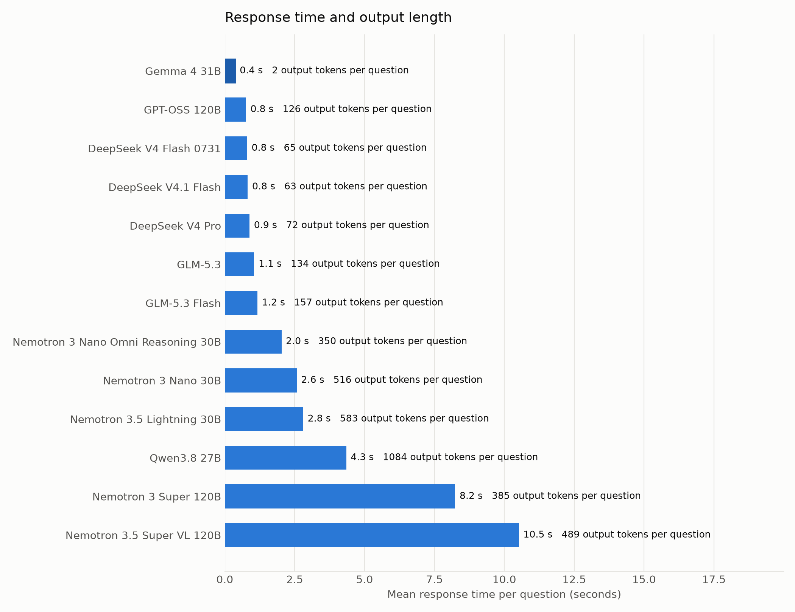

# Every open model on Crusoe sat a West African exam. Ten of thirteen got full marks.

I ran all thirteen chat models on Crusoe Managed Inference against objective questions from the West African Senior School Certificate Examination. On the 37 questions whose answer key held up under review, ten models scored 100 percent, GPT-OSS 120B and Qwen3.8 27B dropped one, and Gemma 4 31B dropped two. The whole run, 533 model answers, cost about 23 cents at list price. The thing that separated the models was not accuracy. It was price, speed, and how many tokens each one burned to reach the same letter. The models also found four wrong answers in the source key.

## Why this exam

WASSCE is the exit exam for secondary school across Ghana, Nigeria, Sierra Leone, Liberia and The Gambia. Around two million candidates sit it every year and it decides who goes to university. Most model benchmarks come from American and European academic traditions. This one asks a question I care about: how well do open models handle material written for the rest of the world, with its own curriculum, its own examples and its own phrasing.

Crusoe serves these models through one OpenAI-compatible endpoint, so the comparison is clean. Same API, same prompt, same key, same afternoon.

## Method

**Dataset.** 41 four-option questions: 29 Integrated Science items from the 2007 paper, taken from the public Hugging Face dataset `worldboss/waec-integrated-science-2007` and converted to a common JSON schema, plus three short sample items each in Core Mathematics, English Language, Integrated Science and Social Studies so that all four subjects are present. The sample items are written in the style of the paper. The bank is in `data/` and the converter in `tools/`.

**Models.** Every chat model the live `/v1/models` endpoint returned on 5 November 2026. The one speech model, Nemotron 3 VoiceChat, was skipped. Four of the thirteen (DeepSeek V4 Flash 0731, DeepSeek V4 Pro, Nemotron 3 Nano 30B, Nemotron 3 Super 120B) were still served but were on the deprecation list dated 2 November 2026, so I kept them in but mark them below.

**Prompt.** One template for every model and question:

```
The following is a multiple choice question from the West African Senior School Certificate Examination (WASSCE) in {subject}.

Question: {question}

A. {option_a}
B. {option_b}
C. {option_c}
D. {option_d}

Answer with just the letter of the correct option.
```

Temperature 0, a single user message, no system prompt. Thinking models were allowed to think; a first pass with a 4,096-token budget cut ten answers off mid-thought, so those were rerun at 16,384 tokens and one Qwen answer at 32,768.

**Scoring.** The parser takes an explicit "answer: X", then a leading letter on the first or last line, then a single standalone letter, then a unique match on the option text. A response with no recoverable letter counts as wrong. After the reruns there were none.

**Cost and latency.** Token counts come from the API's usage field and are priced at the list prices on the Crusoe pricing page that day. Reasoning tokens are billed as output. Latency is the wall-clock time of each successful request from a laptop, averaged per model.

**Reviewing the key.** Four questions were missed by eleven or more of the thirteen models. I checked each one by hand. For the soil experiment, 500 cm3 of water plus 350 cm3 of soil should make 850 cm3; the measured 800 cm3 means 50 cm3 of air, which is 14.28 percent of the sample. The key says 6.25 percent, which divides by the total instead. For the kettle, 2000 W at 240 V draws 8.3 A, and a fuse is chosen as the next standard rating above that, 13 A; the key gives the working current. For the ornamental plants, croton, milk bush and ixora are raised from cuttings and ice plant from seed; the key says milk bush. The heat question, "the quantity of heat in a body does not depend on", lists both density and volume, and neither appears in Q = mcθ, so it is ambiguous. I report two numbers: a reviewed score on the 37 clean questions, and a raw score against the key as published. The four items are listed with reasons in `data/suspect_keys.json`.

## Results

| Rank | Model | Reviewed (37) | All items (41) | Cost per 1k questions | Mean latency | Output tokens per question |
|---|---|---|---|---|---|---|
| 1 | Nemotron 3 Nano Omni Reasoning 30B | 37/37 | 39/41 | $0.67 | 2.0 s | 350 |
| 2 | Nemotron 3.5 Lightning 30B | 37/37 | 38/41 | $0.12 | 2.8 s | 583 |
| 3 | DeepSeek V4 Flash 0731 (deprecated) | 37/37 | 37/41 | $0.03 | 0.8 s | 65 |
| 4 | GLM-5.3 Flash | 37/37 | 37/41 | $0.09 | 1.2 s | 157 |
| 5 | DeepSeek V4.1 Flash | 37/37 | 37/41 | $0.11 | 0.8 s | 63 |
| 6 | Nemotron 3 Nano 30B (deprecated) | 37/37 | 37/41 | $0.11 | 2.6 s | 516 |
| 7 | Nemotron 3.5 Super VL 120B | 37/37 | 37/41 | $0.20 | 10.5 s | 489 |
| 8 | DeepSeek V4 Pro (deprecated) | 37/37 | 37/41 | $0.45 | 0.9 s | 72 |
| 9 | GLM-5.3 | 37/37 | 37/41 | $0.72 | 1.1 s | 134 |
| 10 | Nemotron 3 Super 120B (deprecated) | 37/37 | 37/41 | $0.96 | 8.2 s | 385 |
| 11 | GPT-OSS 120B | 36/37 | 37/41 | $0.04 | 0.8 s | 126 |
| 12 | Qwen3.8 27B | 36/37 | 37/41 | $2.20 | 4.3 s | 1084 |
| 13 | Gemma 4 31B | 35/37 | 35/41 | $0.01 | 0.4 s | 2 |

Ties on the reviewed score are broken by the raw score, then by cost.



The raw column tells a smaller story than it looks. Nemotron 3 Nano Omni Reasoning reaches 39 because it agreed with the published key on the kettle and heat questions; Nemotron 3.5 Lightning reaches 38 because it agreed on the heat question. Nobody picked the key's answer on the soil experiment, and only Qwen3.8 picked milk bush.

### By subject



Integrated Science carries 28 of the 37 reviewed questions and every model but Gemma 4 cleared all of them. Gemma missed the one on which compound forms when an element with two outer electrons meets one with six. The three Social Studies items are where the two other misses landed: GPT-OSS 120B and Qwen3.8 27B both put the Directive Principles of State Policy in the wrong chapter of Ghana's 1992 Constitution. That is the kind of regionally situated fact this benchmark exists to probe, and with three questions it is a hint rather than a finding. Gemma's other miss was the first maths question, a sign error in simplifying 3(2x - 4) - 2(x - 5), answered in two tokens with no reasoning.

### Cost



The spread is 150 to 1 for the same exam. Gemma 4 31B answered every question with a single letter, 82 output tokens for the whole paper, and cost a cent and a half per thousand questions. Qwen3.8 27B thought for about a thousand tokens per question and cost $2.20 per thousand. In between, the DeepSeek and GLM models spent 60 to 160 tokens per question, and the Nemotron family 350 to 580.

The most accurate model, Nemotron 3 Nano Omni Reasoning, sits at 67 cents per thousand, driven by its $1.83 output price. The best value in the current catalog is GLM-5.3 Flash: perfect reviewed score, nine cents per thousand questions, 1.2 seconds a question. DeepSeek V4.1 Flash is the same accuracy, two cents more, and the fastest of the perfect scorers at 0.8 seconds. If you still have access to the deprecated DeepSeek V4 Flash 0731, it was the cheapest perfect scorer of all at three cents, which is a good argument for the V4.1 Flash migration path Crusoe recommends.

### Latency



Latency tracks output length more than model size. The two 120B Nemotron models were slowest, at eight to ten seconds a question, and were also the ones returning 503s from the shared endpoint during the run; their times may reflect load that afternoon rather than the model. The DeepSeek models answered in under a second with 60 to 70 tokens of thought.

## What surprised me

**The ceiling is low.** On a bank of 2007 science and sample questions, the current generation of open models is at or near full marks. The benchmark is saturated in its present size, and the interesting differences are economic.

**The models audited the key.** When thirteen models that otherwise agree on 37 questions all pick the same "wrong" answer, the key is the suspect. The soil arithmetic is simply wrong in the source dataset. This is a cheap, general trick: run a panel of models against any multiple-choice bank before you trust it.

**Thinking is expensive and did not buy accuracy here.** Qwen3.8 spent 44,000 output tokens on 41 questions and missed one that four models answered correctly in under 150 tokens. Nemotron 3.5 Lightning spent 24,000 and scored the same as DeepSeek V4.1 Flash at 2,500.

**Two tokens can be enough.** Gemma 4 returned only the letter, with no reasoning, and still got 35 of 37. Its two misses were both items that reward one line of working.

## Limitations

The bank is small: 41 questions, 32 of them science, and the maths, English and social studies items are three-question samples rather than full papers. Treat every per-subject number as a sketch. The 2007 science questions are old enough to be in training data for any of these models, which is one reason the ceiling is so low. Scores are from a single pass at temperature 0; I did not sample multiple times or shuffle option order. Four keys were overruled by hand, with reasons given, and you can disagree with that by scoring against the raw column. Latency was measured from one laptop during one afternoon, with two endpoints under visible load. Prices are list prices on the run date.

## Reproduce it

```bash
git clone https://github.com/acheamponge/wassce-open-models-benchmark.git
cd wassce-open-models-benchmark
cp .env.example .env
```

Put your Crusoe API key in `.env` as `CRUSOE_API_KEY`.

```bash
uv sync
uv run bench.py --list-models
uv run bench.py
uv run charts.py
uv run tools/per_question.py
```

The runner writes raw per-question records, `summary.csv`, `summary.json`, `by_subject.csv` and `run_meta.json` (date, endpoint, temperature, token budget, prompt template and model ids). It resumes partial runs and retries 429 and 503 responses with backoff. A full run across thirteen models takes about ten minutes, most of it waiting out retries, and costs well under a dollar.

If you have WASSCE past papers with verified keys, especially for Core Mathematics, English and Social Studies, the question bank is the part of this project that needs you. The format is one JSON object per question and the README explains the rest.
